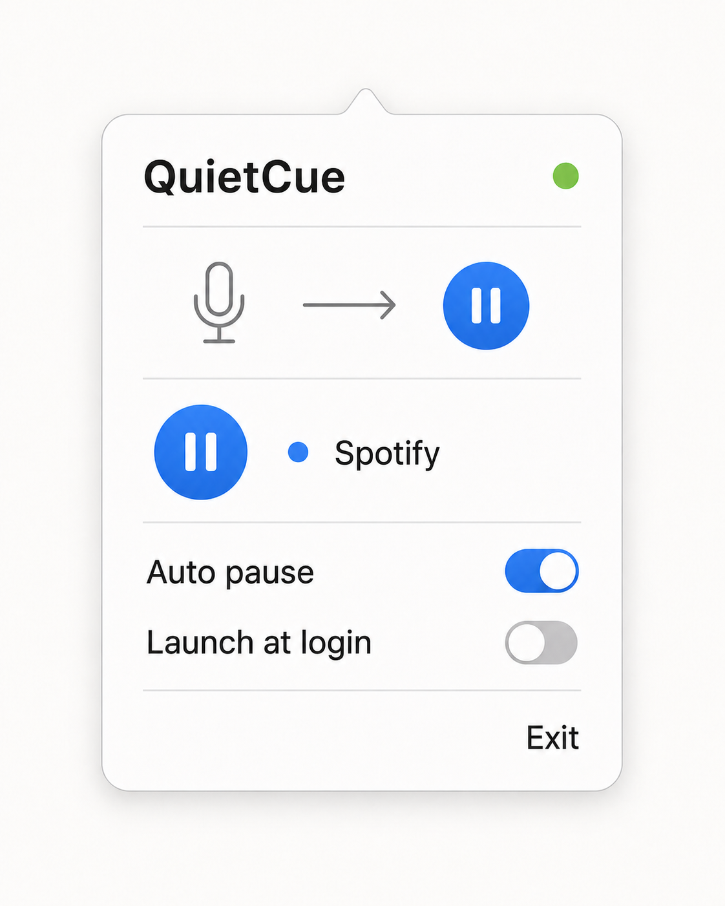

# QuietCue

<p align="center">
  
</p>

<p align="center"><strong>A quiet macOS menu bar utility that pauses the media you are currently playing while the microphone is in use.</strong></p>

## Interface preview

<p align="center">
  
</p>

This is a clean documentation preview of the menu bar experience. The native app stays in the menu bar, shows the current media session, and keeps the controls intentionally compact.

## What it does

QuietCue watches for active microphone processes. When microphone use starts, it asks macOS for the current **Now Playing** session and pauses that session. When microphone use ends, it resumes the same session only if QuietCue still owns the pause.

## Behavior and features

- Watches microphone activity without recording or uploading audio.
- Controls the current Now Playing session instead of pausing every audio app.
- Supports Spotify, Chrome/YouTube, Apple Music, and other players that expose media controls to macOS.
- Manual media changes take precedence: if you switch players, change tracks, or resume playback yourself, QuietCue will not unexpectedly resume the old session.
- Menu bar controls include **Auto pause**, **Launch at login**, and **Exit**.
- The app runs as a lightweight menu bar utility with no Dock window.

## How it works

```text
Microphone becomes active
            ↓
Read the current Now Playing session
            ↓
Pause it and remember ownership
            ↓
Microphone is released
            ↓
Resume only if the same session is still paused
```

## Requirements

- macOS 15 or newer for the current bundled microphone monitor.
- Apple Silicon for the current development build.
- System microphone access when macOS requests it.
- A media player or browser page that exposes Now Playing/media-remote controls.

## Build and run

From the project directory:

```sh
./script/build_and_run.sh --verify
```

The build script compiles the bundled MediaRemote adapter, builds the SwiftPM application, stages a real `QuietCue.app` bundle with the app icon, and launches it from the menu bar. Use `--logs` or `--telemetry` when diagnosing a local build.

## Create a private preview DMG

For a friend-only test build, create an ad hoc-signed DMG:

```sh
./script/package_preview.sh
```

The resulting file is `dist/QuietCue-Preview.dmg`. It is intended for private testing, not public distribution. On first launch, macOS may require a right-click on the app and **Open**.

## Release packaging

The release script creates a Developer ID-signed ZIP. It requires a locally installed `Developer ID Application` certificate:

```sh
./script/package_release.sh
```

After storing Apple notarization credentials in a keychain profile, set `NOTARIZE=1` to submit, staple, and validate the notarized app:

```sh
NOTARIZE=1 NOTARY_PROFILE=quietcue-notary ./script/package_release.sh
```

## Limitations

- QuietCue can only control players that publish a Now Playing/media-remote session to macOS.
- Browser media can depend on the page and Chrome re-registering its media session after a reload; this behavior is controlled by the browser and the page.
- The preview DMG is ad hoc-signed and is not notarized.

## Project layout

```text
Sources/MicPause/       SwiftUI menu bar app and state handling
Vendor/                 Bundled MediaRemote adapter
Assets/                 App icon and README interface preview
script/                 Build, preview-DMG, and release packaging scripts
Tests/                  Swift unit tests
```

## License and acknowledgements

The project includes a bundled MediaRemote adapter under `Vendor/mediaremote-adapter`. See the repository files and the vendor project for applicable license information.
